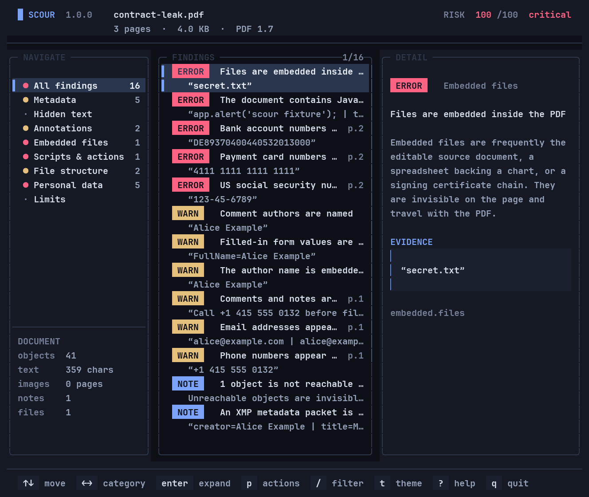
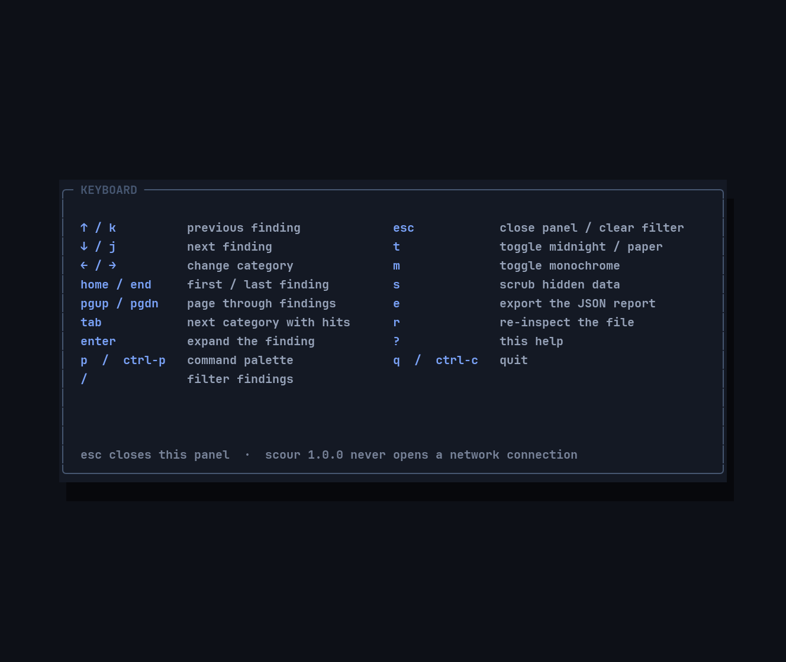
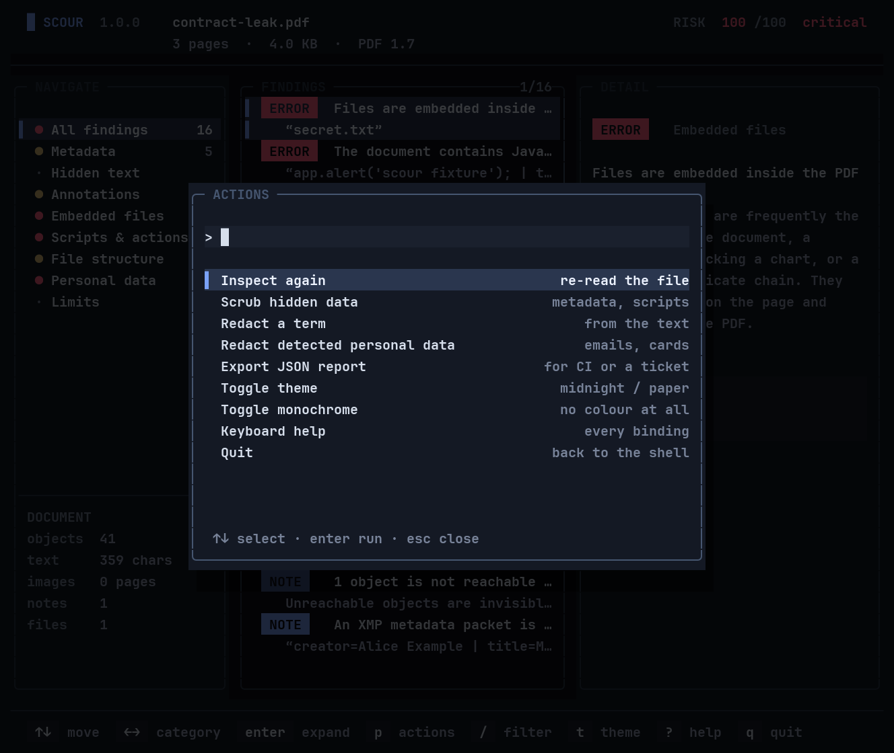

# Scour

**Find what a PDF still says about you. Then remove it — and prove it is gone.**

Scour is a single, offline C++ binary that inspects, redacts, sanitizes and verifies PDF files. It reads the document itself instead of trusting a viewer, removes text at the content-stream level instead of painting over it, rewrites the file from the object graph, and re-opens its own output to prove the target no longer survives.

No account. No upload. No network code. No runtime dependencies.



---

## The problem

A PDF is not a picture of a document. It is a small database: content streams, fonts, annotations, attachments, JavaScript, form values, XMP packets, cross-reference tables and every earlier revision that was appended instead of replaced. A viewer shows one view of that database. A recipient can see another.

That gap has produced a very specific kind of public failure:

- A **93-page TSA screening manual** published in 2009 had its black boxes removed by readers, exposing screening procedures. ([CBS News](https://www.cbsnews.com/news/unredacted-tsa-manual-leaked-online/))
- **Citigroup** exposed personal information — including Social Security numbers and birth dates — in bankruptcy filings affecting nearly **150,000 consumers across 85 jurisdictions**; the remediation included replacement filings, notification, credit monitoring and an independent audit. ([DOJ](https://www.justice.gov/archive/ust/press/docs/2013/pr20130715.htm))
- A **Paul Manafort** court filing in 2019 left the text beneath its black bars selectable and copyable. ([BBC](https://www.bbc.com/news/world-us-canada-46804127))
- A 2021 study of **39,664 PDFs from 75 security agencies in 47 countries** found sensitive information in **65% of the files that had been sanitized**. ([arXiv:2103.02707](https://arxiv.org/abs/2103.02707))
- A 2022 study of **11 popular redaction tools** found two that left the text beneath redactions copyable, and more than **6,000 vulnerable non-excising redactions** in public documents. Even excising tools leaked through character-positioning data. ([arXiv:2206.02285](https://arxiv.org/html/2206.02285v3))

The tools that exist tend to solve one slice of this. Acrobat and Foxit bundle redaction into a subscription suite. Cloud redaction services ask you to upload the sensitive document to a third party. `qpdf` is an excellent structural tool but is not a redactor. `pdf-redact-tools` rasterizes pages, is unmaintained, and warns about malicious input. Some tools remove text but leave metadata; others remove metadata but not earlier revisions; very few tell you what is left.

And the economics have changed. Adobe estimates that more than **3 trillion PDF documents** exist and that customers opened more than **400 billion PDFs in Acrobat products in 2022**. ([Adobe](https://blog.adobe.com/en/publish/2023/06/15/celebrating-30-years-of-digital-transformation-with-adobe-acrobat)) At the same time, GDPR, CCPA/CPRA, HIPAA, FOIA and court rules make "I drew a box over it" an increasingly expensive answer. A redaction failure is not a formatting bug; it is a disclosure.

Scour exists because the safe operation should be the easy one, the result should be inspectable, and the proof should not require trusting the tool that performed the removal.

---

## What Scour does

| Command | What it answers |
|---|---|
| `scour inspect` | What does this file still contain that the page does not show? |
| `scour scrub` | Remove target text, PII, metadata, annotations, attachments and scripts, then rewrite the file. |
| `scour verify` | Re-extract the document and fail if a target survived. |
| `scour tui` | Browse findings, jump to evidence and scrub in place from a terminal. |
| `scour text` | Print the extracted text layer, form-feed separated by page. |
| `scour split` | Write a subset of pages, or one file per page. |
| `scour merge` | Concatenate documents and remap annotations and links. |
| `scour rotate` | Rotate pages without re-rendering them. |

### Inspect

`scour inspect` produces a human report or stable JSON. It scores eight categories — metadata, hidden text, annotations, embedded files, actions, structure, PII and integrity — and explains every finding with the evidence that triggered it.

```text
$ scour inspect contract-leak.pdf

SCOUR REPORT
============
contract-leak.pdf

  Size        4.0 KB
  Format      PDF 1.7
  Pages       3
  Objects     41
  Encryption  none
  Author      Alice Example
  Title       Merger Brief
  Producer    Acme ScanSuite 2.1
  Text        359 characters on 3 pages
  Attachments 1
  Annotations 1

  RISK 100/100  critical
  16 findings, 5 serious, 6 worth a look. The file keeps more than it shows.

METADATA
  [warning] The author name is embedded in the file
      The /Info dictionary names a person. It survives printing, conversion
      and most "remove metadata" settings in office software, and it is the
      first thing a recipient sees.
      > Alice Example

ANNOTATIONS
  [warning] Comments and notes are attached to the document  (page 1)
      Text annotations keep their full contents in the file even when the
      note icon is collapsed...
      > Call +1 415 555 0132 before filing

EMBEDDED
  [error] Files are embedded inside the PDF
      Embedded files are frequently the editable source document...
      > secret.txt

ACTIONS
  [error] The document contains JavaScript
      PDF JavaScript can exfiltrate form data, alter what is displayed and
      run on open depending on the viewer...
      > app.alert('scour fixture'); | this.print();

PII
  [error] Payment card numbers appear in the text  (page 2)
      > 4111 1111 1111 1111
  [error] US social security numbers appear in the text  (page 2)
      > 123-45-6789
```

The inspector does not only look at visible text. It finds text rendered with an invisible rendering mode, text painted white on white, text clipped outside the page, and live text buried under a black rectangle — the four ways a "redaction" is usually faked. It follows form XObjects, so text inside a signature or a stamp is included. It counts earlier revisions and unreachable objects, because those are where the previous version of the page lives.

### Scrub

```text
$ scour scrub contract-leak.pdf -o safe.pdf --pii --term "Project Bluebird"

SCRUBBED  contract-leak.pdf -> safe.pdf

  size         4.0 KB -> 1.9 KB
  objects      12 written, 11 dropped
  metadata     removed
  annotations  3 removed
  attachments  2 removed
  actions      4 removed
  glyphs       127 removed
  boxes        8 painted
  note         removed 4 action/script entries
  note         removed 3 annotation(s)
  note         removed document information, XMP and application data

  verified     re-opened the output; the targets are gone from the text layer
```

A scrub is a removal pass, not a paint pass:

1. **Text is removed from the content stream.** Each matching glyph is replaced with a space glyph of the same width, or with a width-preserving adjustment, so the layout does not jump. The original characters are not in the output file.
2. **Metadata is deleted, not blanked.** `/Info`, `XMP`, `/PieceInfo` and application data are removed from the trailer and catalog. A rewrite then drops every object that is no longer reachable.
3. **Annotations, form fields, attachments and actions are removed from the object graph.** A file that simply hides a comment still ships the comment.
4. **The file is rebuilt.** Incremental updates are dropped. Earlier revisions, orphaned objects and stale `/Info` references do not survive a full rewrite.
5. **The result is verified.** Scour re-opens the bytes it just wrote, re-extracts the text and reports anything that is still there. A failed verification exits `1`.

### Verify

```text
$ scour verify safe.pdf --pii --term "Project Bluebird"
CLEAN  safe.pdf
  pages scanned  3
  remaining      0
```

`verify` is deliberately usable on a file you did not create with Scour. It only needs the output and the targets. That makes it suitable as a CI gate or a release checklist step.

### TUI

The dashboard is a first-class interface, not a wrapper around the report. It has a navigable category sidebar, a findings list with evidence, a detail pane, search, a command palette, keyboard help, a light "paper" theme and an in-place scrub flow. It repaints only the cells that changed and handles wide glyphs and combining marks.

It also behaves at the edges. Below 64×18 the frame is replaced by a `WINDOW TOO SMALL` panel that states the requirement, the current size and the plain-report fallback, instead of drawing a collapsed layout. `--no-color`, `NO_COLOR` or the `m` key runs it monochrome: colour disappears, and severity, selection and structure survive through words, glyphs and weight. Every text pair is measured at 4.5:1 or better in both themes. The rules behind those choices are in [docs/DESIGN.md](docs/DESIGN.md).





| Key | Action |
|---|---|
| `↑` / `k`, `↓` / `j` | previous / next finding |
| `←` / `→`, `tab` | change category |
| `home` / `end`, `pgup` / `pgdn` | first / last, page through findings |
| `enter` | expand the selected finding |
| `/` | filter findings |
| `p` / `ctrl-p` | command palette |
| `m` | toggle monochrome |
| `s` | scrub hidden data |
| `e` | export the JSON report |
| `t` | toggle midnight / paper |
| `?` | keyboard help |
| `q` | quit |

---

## Install

### Prebuilt binaries

Every tagged release attaches one file per target. Nothing to install, no shared libraries to match:

| Target | Archive |
|---|---|
| Linux x86-64 | `scour-1.0.0-linux-x86_64.tar.gz` |
| Linux arm64 | `scour-1.0.0-linux-aarch64.tar.gz` |
| macOS arm64 | `scour-1.0.0-macos-arm64.tar.gz` |
| macOS x86-64 | `scour-1.0.0-macos-x86_64.tar.gz` |

```bash
tar -xzf scour-1.0.0-linux-x86_64.tar.gz
./scour-1.0.0-linux-x86_64/scour inspect scour-1.0.0-linux-x86_64/fixtures/contract-leak.pdf
```

The Linux binaries are fully static, so there is no glibc floor; the macOS builds require macOS 13 or newer. Each archive carries the man page, the sample fixtures and a `.sha256` sidecar, and `SHA256SUMS.txt` on the release page covers all four.

### From source

Scour has no runtime dependencies. A release build needs CMake 3.20+ and a C++20 compiler (GCC 11+, Clang 14+).

```bash
cmake -S . -B build -DCMAKE_BUILD_TYPE=Release
cmake --build build -j
sudo cmake --install build --prefix /usr/local
```

Or run it from the build tree:

```bash
./build/scour --help
```

To link the C++ runtime statically (the result still uses the system libc):

```bash
cmake -S . -B build-static -DCMAKE_BUILD_TYPE=Release \
  -DCMAKE_EXE_LINKER_FLAGS="-static-libstdc++ -static-libgcc"
```

`tools/release.sh <triple>` does the whole release path — build, tests, strip, package, and a run of the extracted archive — for the four targets above.

Scour runs on Linux and macOS. Windows is not a supported target for the CLI: the terminal layer is `isatty`, `termios`, `ioctl` and `SIGWINCH`, with no equivalent reachable without a separate console backend, so a Windows build produces the engine, the fixtures and the tests but not the `scour` binary — configuring says so and `ctest` still runs the full suite. To use Scour on Windows, run the static Linux binary under WSL2.

### Build options

| Option | Default | Meaning |
|---|---|---|
| `SCOUR_BUILD_TESTS` | `ON` | build the unit and end-to-end tests |
| `SCOUR_BUILD_TOOLS` | `ON` | build `scour_fixtures`, which regenerates the sample PDFs |
| `SCOUR_BUILD_BENCH` | `OFF` | build the micro-benchmark |
| `SCOUR_WARNINGS_AS_ERRORS` | `OFF` | treat warnings as errors |
| `SCOUR_SANITIZE` | `OFF` | AddressSanitizer + UndefinedBehaviorSanitizer |
| `SCOUR_NATIVE` | `OFF` | tune for the host CPU (never for redistributable binaries) |

---

## Usage

### Common workflows

```bash
# What is in this file?
scour inspect brief.pdf

# Machine-readable report for a script or CI
scour inspect brief.pdf --json > brief.report.json

# Remove every detector and a project codename
scour scrub brief.pdf -o brief.safe.pdf --pii --term "Project Bluebird"

# Remove a rectangle on page 2 (PDF user space, points)
scour scrub brief.pdf -o brief.safe.pdf --rect 2:60,700,560,740

# Scrub metadata and comments only, leaving the text layer untouched
scour scrub brief.pdf -o brief.safe.pdf --no-redact

# Replace the input atomically
scour scrub brief.pdf --in-place --pii

# Prove it, even months later
scour verify brief.safe.pdf --pii --term "Project Bluebird"
```

### Exit codes

The exit code is a contract, because the point of this tool is to be usable from CI and from other scripts.

| Code | Meaning |
|---|---|
| `0` | success; nothing was left to report |
| `1` | success, but findings remain (inspect: risk at or above `--fail-on`; scrub/verify: the target survived) |
| `2` | usage error |
| `3` | the input could not be opened, decrypted or parsed |
| `4` | the output could not be written or failed verification |

`scour inspect --fail-on N` defaults to `10`. A clean file exits `0`; an unreadable file is always `3`, never a misleading "clean" report. This is the difference between a scanner and a check that can be wired into a release pipeline.

### JSON

The JSON report has a stable shape and a `format` field for forward-compatible consumers:

```json
{
  "tool": "scour",
  "format": 1,
  "risk": 100,
  "grade": "critical",
  "headline": "16 findings, 5 serious, 6 worth a look. The file keeps more than it shows.",
  "facts": { "pages": 3, "objects": 41, "revisions": 2, "encrypted": false },
  "scores": [
    { "category": "metadata", "points": 17, "maximum": 28, "findings": 5 }
  ],
  "findings": [
    {
      "id": "metadata.author",
      "category": "metadata",
      "severity": "warning",
      "title": "The author name is embedded in the file",
      "detail": "The /Info dictionary names a person...",
      "evidence": "Alice Example",
      "page": 0
    }
  ]
}
```

### Full command reference

See [docs/CLI.md](docs/CLI.md) for every option, page-list syntax, rectangle coordinates, password handling and examples.

---

## How it works

Scour is a PDF reader, writer, text extractor and content-stream editor written from scratch. There is no PDF library underneath it.

```text
                    ┌─────────────────────────────────────────────┐
  file bytes ──────▶│ lexer / parser / xref / object streams      │
                    │ repair scan · incremental revisions · crypt │
                    └──────────────────────┬──────────────────────┘
                                           │
                    ┌──────────────────────▼──────────────────────┐
                    │ page tree · resources · content streams     │
                    │ font encodings · glyph geometry · paint ops │
                    └──────────────┬───────────────┬──────────────┘
                                   │               │
                    ┌──────────────▼─────┐   ┌─────▼─────────────┐
                    │ inspector          │   │ redactor          │
                    │ 8 categories       │   │ glyph replacement │
                    │ risk + evidence    │   │ box painting      │
                    └──────────────┬─────┘   └─────┬─────────────┘
                                   │               │
                    ┌──────────────▼───────────────▼─────────────┐
                    │ sanitizer: metadata, annotations, forms,   │
                    │ attachments, actions, name trees           │
                    └──────────────────────┬─────────────────────┘
                                           │
                    ┌──────────────────────▼─────────────────────┐
                    │ writer: fresh xref, reachable objects only │
                    │ deterministic /ID, atomic replacement      │
                    └──────────────────────┬─────────────────────┘
                                           │
                    ┌──────────────────────▼─────────────────────┐
                    │ verification: re-open, re-extract, compare │
                    └────────────────────────────────────────────┘
```

The core library (`scour_core`) has no terminal or CLI code. `scour` adds the commands and a self-contained TUI (`src/tui/screen.cpp` is a cell buffer with truecolor, diffed repaints and wide-glyph handling; `src/tui/app.cpp` is the dashboard).

More detail: [docs/ARCHITECTURE.md](docs/ARCHITECTURE.md).

### What is actually implemented

- **PDF 1.0–2.0 structure**: classic xref tables, xref streams, object streams, hybrid files, incremental updates, broken-xref repair by scanning.
- **Filters**: Flate, LZW, ASCII85, ASCIIHex, RunLength and the predictor functions used with them.
- **Encryption**: Standard security handler revisions 2–6, RC4, AES-128 and AES-256, owner and user passwords, `/EncryptMetadata`.
- **Text**: simple fonts, Type0/CID fonts, ToUnicode CMaps, standard encodings, widths, rendering modes, text and graphics state, form XObjects with depth limiting.
- **Inspection**: metadata, XMP, hidden/covered/white/clipped text, annotations, form values, attachments, JavaScript and launch actions, unreachable objects, revisions, PII detectors, image-only pages.
- **Editing**: glyph-level redaction with width preservation, rectangle redaction, metadata and object-graph sanitization, page extraction, merge, rotation.
- **Output**: full rewrite with a fresh cross-reference table, reachable-object collection, deterministic `/ID`, optional recompression, atomic writes.

### The text path is the hard part

A PDF does not store "the word confidential". It stores bytes in a font-specific encoding, positioned by a matrix, spaced by widths, sometimes split across several `Tj` operators, sometimes inside a form that is drawn twice. Scour resolves the font encoding to Unicode, tracks the text and graphics state, computes each glyph's page-space box, and keeps the byte span of every decoded character. A redaction is then a byte-level edit of the encoded string — not a search-and-replace on the rendered page.

That is also why split runs work. `Contact: alice@exam` followed by `ple.com` is one target, and Scour joins the runs before matching while keeping enough mapping to rewrite both operands and preserve the advance width. The test suite contains this case because it is the one most naive redactors get wrong.

### Design choices

**Rewrite, never increment.** Removing a key from an incrementally saved PDF does not remove the previous value; it appends a new version. Scour always writes a new file from the live object graph and a fresh xref. That is the only way to make "removed" mean removed.

**Remove text, do not cover it.** A painted rectangle is an annotation about the document, not a change to it. Scour replaces the glyphs and optionally paints the box; the box is cosmetic, the removal is structural.

**Verify against the output.** The scrubber does not trust its own in-memory state. It reopens the bytes on disk, extracts the text again and fails if the target is still there. This catches writer bugs and encoder bugs, not just matcher bugs.

**No dependencies.** A privacy tool that pulls in a large rendering stack has a large attack surface and a supply chain. The binary links only against the C++ runtime and the system C library. There is no network code to disable, because none was written.

**Deterministic output.** Scrubbing the same input twice produces byte-identical output. That makes changes reviewable, allows hash-based tests, and makes CI diffs meaningful. The `/ID` is derived from the content, not random.

**Warnings are information, not noise.** The inspector separates facts (what the file contains) from inference (what it might mean). Absent values stay empty; nothing is guessed. Findings are aggregated per page and category, so a page with two thousand invisible glyphs produces one finding, not two thousand.

**A real test harness.** Fixtures are written by hand, byte for byte, not by Scour's own writer. A bug shared by the reader and writer cannot hide behind a round-trip test. The suite covers malformed xrefs, CR-only line endings, split runs, encrypted files, object streams and the four ways of hiding text.

---

## Performance

Measured on a 2-vCPU Linux container with GCC 13.3, `-O3`, a 1,000-page synthetic report (30 text lines per page, 1,292,612 glyphs, 533 KB compressed). Median of three runs:

| Operation | Time | Notes |
|---|---:|---|
| open + parse | 1.9 ms | lazy objects; xref and page tree only |
| extract text | 169 ms | 7.6 M glyphs/s |
| inspect + PII scan | 175 ms | all eight categories |
| rewrite only | 7.4 ms | fresh xref, reachable objects only |
| scrub + rewrite | 0.45 s | PII plus one term; glyph removal across 1,000 pages |
| full `scour scrub` (incl. verification) | 0.68 s | CLI, PII plus one term, re-open and re-extract |
| peak RSS | 202 MB | text analysis retains glyph geometry |

On a 300-page, 385k-glyph report, `scour text` takes **90 ms** end to end (process start included) versus **826 ms** for pypdf 6.21.2 extracting the same pages; `scour inspect` takes **55 ms**. The comparison measures different work — pypdf is pure Python and has no PII scanner — so treat it as an order-of-magnitude check, not a benchmark win. The reproducible benchmark is in [`bench/bench.cpp`](bench/bench.cpp):

```bash
cmake -S . -B build -DSCOUR_BUILD_BENCH=ON -DCMAKE_BUILD_TYPE=Release
cmake --build build -j
./build/scour_bench --pages 1000 --lines 30 --iterations 3
```

---

## Verification

Correctness is not a claim; it is a set of checks you can rerun.

- **118 unit tests** cover the lexer, parser, xref repair, object streams, filters, RC4/AES, text encodings, redaction, sanitization, the inspector and the writer.
- **End-to-end CLI tests** drive the real binary: exit codes, atomic writes, in-place scrubbing, split/merge/rotate, TUI dumps, the 64×18 minimum-size state and monochrome output.
- **External interoperability** is checked against two independent implementations. `tools/verify_external.py` builds documents with **pikepdf** and **pypdf**, runs Scour against them, then re-opens Scour's output with both libraries and checks syntax, metadata, annotations, attachments, pages and extracted text. 43/43 checks pass with pikepdf 10.17.0 and pypdf 6.21.2. See [docs/VERIFICATION.md](docs/VERIFICATION.md).
- **Fuzzing**: a sanitizer-instrumented harness drives the whole pipeline — open, inspect, extract, scrub, rewrite, re-open, verify — over mutated documents. It has already paid for itself: the first campaign found an integer overflow in number parsing, now fixed and pinned by a test. See [docs/FUZZING.md](docs/FUZZING.md).
- **Sanitizers**: the suite runs under ASan and UBSan in CI.
- **Windows CI**: the engine and unit test suite build with MSVC and run under `windows-latest` on every push, verifying engine functionality and UTF-8 handling.
- **Release artefacts** are built by `tools/release.sh`, which also unpacks the archive and drives the stripped, statically linked binary from outside its build tree. A release is only published if that run passes on all four targets.

```bash
cmake -S . -B build && cmake --build build -j
./build/tests/scour_tests
bash tests/cli_e2e.sh ./build/scour ./build/scour_fixtures /tmp/scour-e2e
python3 tools/verify_external.py --scour build/scour

# fuzz the parser and the redactor (sanitizers required)
cmake -S . -B build-fuzz -DCMAKE_BUILD_TYPE=Debug \
      -DSCOUR_SANITIZE=ON -DSCOUR_BUILD_FUZZ=ON -DSCOUR_BUILD_TESTS=OFF
cmake --build build-fuzz -j
./build-fuzz/scour_fuzz --corpus fixtures --iterations 25000 --seed 1

# build, test and verify a release archive for this platform
bash tools/release.sh linux-x86_64

# rebuild the documentation screenshots from real frames (needs Pillow and a
# monospaced TTF; the font is not vendored)
python3 tools/screenshots.py --font /path/to/JetBrainsMono-Regular.ttf
```

---

## Limits

Scour is deliberately honest about what it cannot do.

- **Text inside images is not text.** A scan of a redacted page can still show the original words. Scour reports image-only pages and refuses to claim they are clean; it does not OCR them.
- **A password is required.** AES-256 and RC4 documents are supported, but without the password there is nothing to inspect or scrub. Scour exits `3` instead of pretending the file is clean.
- **Redaction changes the text, not the layout.** Removed glyphs become spaces of the same width. If a reader copies the text, the spaces remain; that is the point.
- **Fonts with no reliable Unicode mapping are flagged.** Scour warns when a font's encoding cannot be trusted rather than inventing characters.
- **Signatures are invalidated.** Rewriting a signed document breaks the signature. That is inherent to changing the bytes; Scour does not preserve a signature over modified content.
- **PII detection is a filter, not a compliance certification.** Detectors find common formats; they can miss context-dependent identifiers and can produce false positives. Review the findings, then verify the output.
- **A clean report is not a malware scan.** Scour removes active content; it does not analyze exploit code.

The full threat model, including what verification does and does not prove, is in [docs/THREAT-MODEL.md](docs/THREAT-MODEL.md).

---

## Why this product, why now

The short version: PDFs are everywhere, redaction failures are common and expensive, existing tools are either heavyweight subscriptions, cloud uploads, or low-level components, and the privacy-conscious part of the market has no fast, local, verifiable default.

Scour is positioned as the **safe default for the document you are about to send**: one binary, no upload, a report a non-expert can read, a scrub that removes rather than covers, and a verification step that can be automated. It is also a credible open-source building block for teams that need to put a redaction gate in a release pipeline.

The longer analysis — personas, competitive pricing, market sizing assumptions, launch plan, publicity and social strategy, risks and roadmap — is in [docs/MARKET.md](docs/MARKET.md).

---

## Development

```bash
# debug + sanitizers
cmake -S . -B build-asan -DCMAKE_BUILD_TYPE=Debug -DSCOUR_SANITIZE=ON
cmake --build build-asan -j
./build-asan/tests/scour_tests

# regenerate the sample documents
./build/scour_fixtures fixtures

# run one suite
./build/tests/scour_tests --filter=redact

# Windows (MSVC — engine and tests only; CLI/TUI require POSIX)
cmake -S . -B build-msvc -A x64
cmake --build build-msvc --config Release
./build-msvc/tests/Release/scour_tests.exe
```

The test harness is intentionally dependency-free. See [CONTRIBUTING.md](CONTRIBUTING.md) for the fixture policy, coding style and review checklist.

---

## Documentation

- [CLI reference](docs/CLI.md)
- [Interface design system](docs/DESIGN.md)
- [Architecture and data flow](docs/ARCHITECTURE.md)
- [Threat model and verification semantics](docs/THREAT-MODEL.md)
- [Market thesis, personas and launch plan](docs/MARKET.md)
- [External verification report](docs/VERIFICATION.md)
- [Fuzzing guide](docs/FUZZING.md)
- [Security policy](SECURITY.md)
- [Changelog](CHANGELOG.md)

---

## License

MIT. See [LICENSE](LICENSE).

Scour is named for the act of reading a document closely. It has no telemetry, no analytics, no crash reporting and no update check. If you want to know what it does, read the source; that is the entire point.
